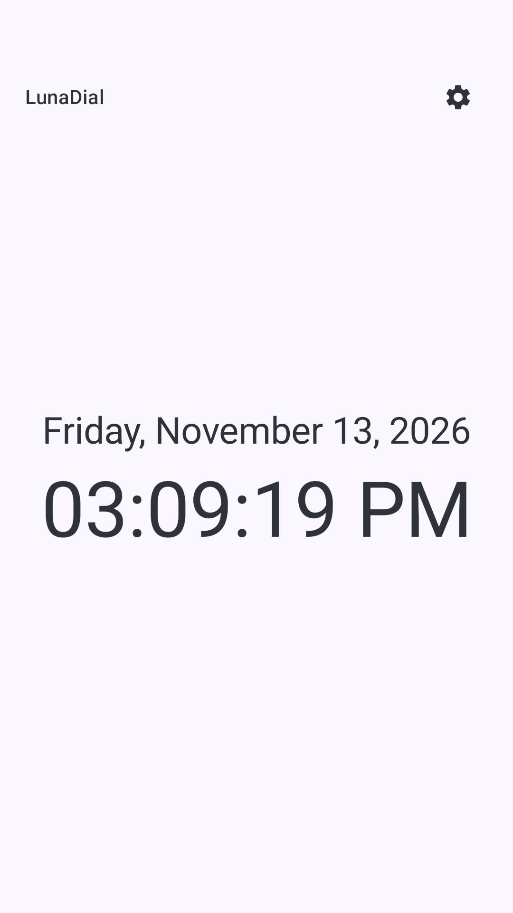
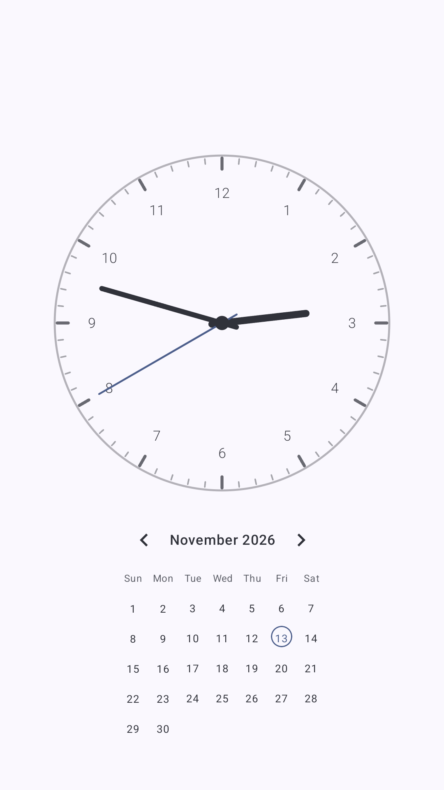
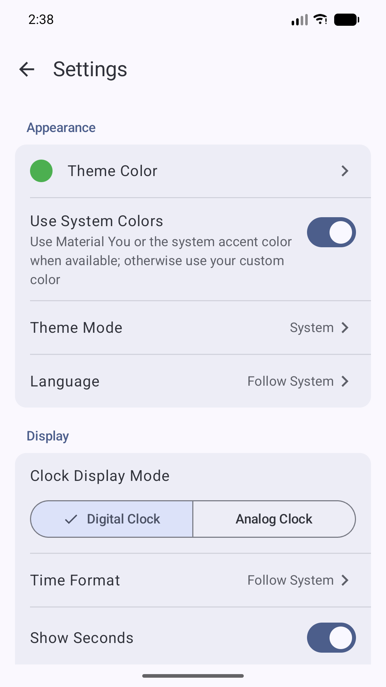
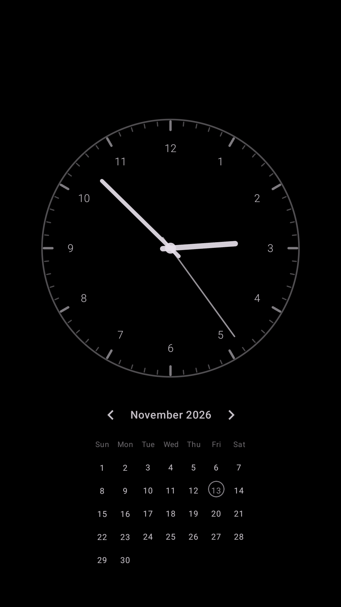

# LunaDial

LunaDial is a free, open-source clock app for Android phones and tablets. It is easy to read, uses few resources, and is comfortable to leave running — on a desk, a nightstand, or a spare display.

<table>
  <tr>
    <td></td>
    <td></td>
  </tr>
  <tr>
    <td></td>
    <td></td>
  </tr>
</table>

## Download

- GitHub: Download `app-release.apk` from the [latest release](https://github.com/GT-610/lunadial/releases/latest) for your artitecture.
- F-Droid: Submission is in progress.

## Features

- Digital and analog clocks, with an optional calendar
- 12- or 24-hour time, seconds, a second hand, and leading zeros
- Light, dark, or system appearance, with system, Material You, or custom accent colors
- A dimmer night display that you can enable manually, schedule, or follow the system theme
- An option to keep the screen awake
- Subtle periodic movement during extended night display to reduce OLED burn-in risk
- English and Simplified Chinese

## Privacy

LunaDial does not need network access and does not collect usage data. Your preferences stay on your device.

## Building from source
You can use Android Studio, or:

| Component | Version |
|---|---|
| JDK | Temurin 25 |
| Gradle | 9.7.0 (via the wrapper) |
| Android Gradle plugin | 9.3.1 |
| Kotlin | 2.4.21 |
| compileSdk / targetSdk / minSdk | 37 / 36 / 24 |

```bash
export JAVA_HOME=/Library/Java/JavaVirtualMachines/temurin-25.jdk/Contents/Home
export ANDROID_HOME=/path/to/android-sdk            # needs platforms;android-37.0 and build-tools;37.0.0

./gradlew :app:assembleDebug                        # debug APK
./gradlew :app:assembleRelease :app:bundleRelease    # release APKs + App Bundle
```

Release builds are signed when `key.properties` exists in the repository root:

```properties
storeFile=lunadial-release.jks
storePassword=…
keyAlias=…
keyPassword=…
```

Otherwise the release build produces unsigned APKs.

## Help and contributing

Found a problem or have an idea? Please [open an issue](https://github.com/GT-610/lunadial/issues). Contributions are welcome.

## License

[GNU General Public License v3.0](LICENSE)
